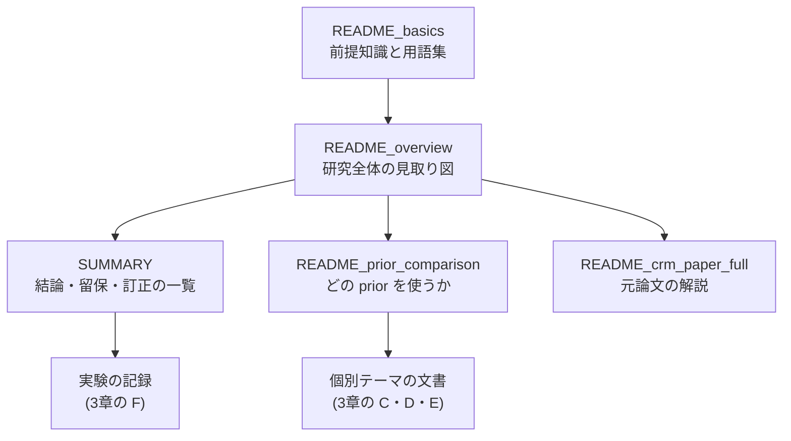

# 文書の地図 — どこに、何について書いてあるか

[README.md](README.md) に戻る

この研究(Hubbard 模型に対する CRM シャドウ)の文書は 30 個ほどあり、書いた時期も目的もばらばらである。この文書は、それらを**役割ごとに整理した索引**である。新しい内容は含まない。

使い方は4通りある。

- 何から読めばよいかわからない → 1章(読む順番)
- 知りたいことが決まっている → 2章(知りたいことから引く)
- ある文書が何の文書かを知りたい → 3章(文書の一覧)
- 「§2b」のような節番号がどの文書にあるかを知りたい → 4章

---

## 1. 読む順番

| 読む人 | 読む順番 |
|---|---|
| 初めて読む。量子情報も物性物理も詳しくない | [README_basics.md](README_basics.md) → [README_overview.md](README_overview.md) → [README_prior_comparison.md](README_prior_comparison.md) |
| 研究の結論を短く知りたい | [README_overview.md](README_overview.md) → [SUMMARY.md](SUMMARY.md) |
| 手法(CRM)そのものを理解したい | [README_basics.md](README_basics.md) の3〜4章 → [README_crm_paper_full.md](README_crm_paper_full.md) の0〜5章 → [README_crm_paper.md](README_crm_paper.md) |
| 実際に prior を選びたい | [README_prior_comparison.md](README_prior_comparison.md) の0章と8章 |
| 個々の数値の出どころを確かめたい | [README.md](README.md) の0章(記号の辞書) → 4章の対応表で節を探す |
| 久しぶりに読み返す | [README_overview.md](README_overview.md) |

---

## 2. 知りたいことから引く

### 言葉と記号

| 知りたいこと | 文書と場所 |
|---|---|
| 専門用語の意味 | [README_basics.md](README_basics.md) 8章(用語集) |
| 記号 $L$ 、 $W$ 、 $U$ 、 $\chi$ 、 $n_u$ 、 $n_m$ 、 $G$ 、 $\Delta$ 、 $F$ 、 $\lvert A\rvert$ | [README.md](README.md) 0章、[README_basics.md](README_basics.md) |
| 表に出てくる観測量の名前(ZZ onsite、SzSz など)の意味 | [README.md](README.md) 0.3b 節、[README_basics.md](README_basics.md) 5.8 節 |
| 各観測量の物理的な意味 | [paper/crm_observables.pdf](paper/crm_observables.pdf)、[paper/crm_double_occupancy.pdf](paper/crm_double_occupancy.pdf) |
| 表の数値の読み方と、どこまで信用できるか | [README.md](README.md) 0.6 節、0.8 節、[README_basics.md](README_basics.md) 7章 |

### 手法

| 知りたいこと | 文書と場所 |
|---|---|
| 古典シャドウとは何か、なぜ $3^{\lvert A\rvert}$ 倍するのか | [README_basics.md](README_basics.md) 3章 |
| CRM とは何か、なぜ偏らないのか | [README_basics.md](README_basics.md) 4章、[README_crm_paper_full.md](README_crm_paper_full.md) 4章 |
| 利得の式の導出 | [README_basics.md](README_basics.md) 3.4 節と 4.3 節(短い)、[README_crm_paper_full.md](README_crm_paper_full.md) 5章(論文に沿った導出)、[README_prior_survey.md](README_prior_survey.md)「利得はどう求めたか」 |
| 利得の式が測定の模擬と合うことの確認 | [README_gainlaw.md](README_gainlaw.md)(128 量子ビットまで)、[README.md](README.md) §1(8 量子ビット) |
| 元論文に何が書いてあり、この研究は何を加えたか | [README_crm_paper.md](README_crm_paper.md) |
| 設定の数 $n_u$ とショットの数 $n_m$ をどう決めるか | [README.md](README.md) 0.5b 節、[README_prior_survey.md](README_prior_survey.md)「 $n_u$ と $n_m$ の影響」 |
| 損をしない推定(最適係数)、複数の prior の組み合わせ | [README_experiments.md](README_experiments.md) §2d、§6 |
| 和で書ける観測量の分散の式 | [README_observables.md](README_observables.md) 5.1 節、[README_experiments.md](README_experiments.md) §3 |
| 読み出し誤差があるとき | [README_readout_noise.md](README_readout_noise.md) |
| 別の測定法(matchgate シャドウ)との組み合わせ | [README_experiments.md](README_experiments.md) §5、[fermion_shadow_kaisetsu.pdf](fermion_shadow_kaisetsu.pdf)(その測定法の元論文の解説) |
| 既存の方法(derandomization)との比較 | [README_experiments.md](README_experiments.md) §7 |

### prior

| 知りたいこと | 文書と場所 |
|---|---|
| どの prior を、どの観測量に使うか | [README_prior_comparison.md](README_prior_comparison.md) |
| UHF-sym(向きを平均した平均場)とは何か | [README_uhfsym.md](README_uhfsym.md) |
| スピン射影(PHF)と、小さい結合次元の MPS の性質 | [README_phf_mps.md](README_phf_mps.md) |
| 変分 MPS を回転平均した prior | [README_varsym.md](README_varsym.md) |
| 遠く離れたスピン相関で、どの prior が損をするか | [README_varsym_distance.md](README_varsym_distance.md)、[README_eigenstate.md](README_eigenstate.md) 4章 |
| 平均場はなぜスピンの向きを選ぶのか | [README_uhfsym.md](README_uhfsym.md) 1章、[README_observables.md](README_observables.md) 3.1 節 |
| prior の対称性を平均で戻す一般的な考え方 | [README.md](README.md) §2j |

### 観測量と物理

| 知りたいこと | 文書と場所 |
|---|---|
| 観測量によって利得が違う理由(天井と外れ) | [README_observables.md](README_observables.md) 1〜4章 |
| prior がはっきりした値を予言するほど良いのか | [README_eigenstate.md](README_eigenstate.md) |
| 損得の境目(prior の値が真の値の 0〜2 倍) | [README_eigenstate.md](README_eigenstate.md) 1.4 節、[README_basics.md](README_basics.md) 4.3 節 |
| 半充填でサイトの電子の数がちょうど 1 になる理由 | [README_particle_hole.md](README_particle_hole.md) |
| 相互作用の強さ $U$ による違い | [README_prior_survey.md](README_prior_survey.md) 結果2、[README_prior_comparison.md](README_prior_comparison.md) 7.1 節 |
| 鎖の場所による利得の違い、端の影響 | [README_experiments.md](README_experiments.md) §2b、§2c |

### 忠実度と「局所性」

| 知りたいこと | 文書と場所 |
|---|---|
| 系を大きくしても利得が保たれること | [README.md](README.md) §2、[README_experiments.md](README_experiments.md) §2b、[README_prior_survey.md](README_prior_survey.md) |
| 忠実度が利得を決めない理由と、その留保 | [README_prior_survey.md](README_prior_survey.md)「何が利得を決めているのか」「検証」 |
| 観測量の近くだけを見た近さ(台の忠実度、トレース距離)で利得が決まるか | [README_2m.md](README_2m.md) |
| なぜ忠実度ではなくトレース距離か(数学的な理由) | [README_distance_vs_fidelity.md](README_distance_vs_fidelity.md) |
| 局所性が成り立つ条件(ギャップの有無) | [README_experiments.md](README_experiments.md) §2e |

### 2次元とドープした系

| 知りたいこと | 文書と場所 |
|---|---|
| 2次元で平均場が MPS の代わりになるか | [README_experiments.md](README_experiments.md) §4、§8、[README_prior_comparison.md](README_prior_comparison.md) 7.3 節 |
| 2次元の境界条件の影響 | [README.md](README.md) §2k |
| ドープした系(ストライプ)での prior | [README_experiments.md](README_experiments.md) §4b、§9 |

### 研究の状態

| 知りたいこと | 文書と場所 |
|---|---|
| 確かめられた結論と、その留保 | [SUMMARY.md](SUMMARY.md)「主要な結論」「わかっている限界」 |
| 後から訂正・撤回した主張 | [SUMMARY.md](SUMMARY.md)「撤回・訂正の記録」 |
| 次にやる候補 | [README_overview.md](README_overview.md) 4章、[README.md](README.md)「今後の課題」 |
| スクリプトとデータのファイル名、再現の方法 | [README.md](README.md)「ファイル一覧」「再現方法」、各文書の冒頭と末尾 |
| 図の一覧 | [README.md](README.md)「図」の2つの節、[README_prior_survey.md](README_prior_survey.md)「図の一覧」 |

---

## 3. 文書の一覧

「説明の丁寧さ」の列の意味は次のとおりである。

- **丁寧**: 冒頭に読み方の案内と用語表があり、本文でも用語をその場で説明し、式の途中を省いていない。
- **丁寧(記録)**: 冒頭に読み方の案内と用語表、各節の頭に一言の要約があり、本文でも用語と表の読み方を説明している。実験の記録なので、検証の細部や途中の誤りの経緯も残してある。
- **専門的**: 研究を進める側の覚え書きで、説明なしに専門用語を使う。

### A. 入口

| 文書 | 内容 | 説明の丁寧さ |
|---|---|---|
| [README_basics.md](README_basics.md) | 前提知識の準備。確率と統計、量子ビットの測定、古典シャドウ、CRM、Hubbard 模型、平均場と MPS。巻末に用語集 | 丁寧 |
| [README_overview.md](README_overview.md) | 研究全体の見取り図。道具立て、主な発見、注意点、次の候補 | 丁寧 |
| [SUMMARY.md](SUMMARY.md) | 結論の一覧、実験の一覧、撤回・訂正の記録、限界、実務上の指針 | 丁寧 |
| README_index.md(この文書) | 文書の索引 | — |

### B. 手法と元論文

| 文書 | 内容 | 説明の丁寧さ |
|---|---|---|
| [README_crm_paper_full.md](README_crm_paper_full.md) | 元論文(Vermersch ら 2024)の全節・全付録の解説。式の導出つき | 丁寧 |
| [README_crm_paper.md](README_crm_paper.md) | 元論文のどの式をこの研究が使い、何を加えたかの対応 | 丁寧 |
| [README_gainlaw.md](README_gainlaw.md) | 利得の式と、測定の模擬との一致の確認(128 量子ビットまで) | 丁寧 |
| [README_readout_noise.md](README_readout_noise.md) | 読み出し誤差があるときの利得と、prior の側での補正 | 丁寧 |
| [crm_shadow_kaisetsu.pdf](crm_shadow_kaisetsu.pdf) | 元論文の入門的な解説(PDF、13 ページ、2026年7月) | 丁寧 |
| [paper/crm_tutorial.pdf](paper/crm_tutorial.pdf) | 物性の用語と、この研究の式を一から追う自習用の解説(PDF、19 ページ) | 丁寧 |

### C. prior

| 文書 | 内容 | 説明の丁寧さ |
|---|---|---|
| [README_prior_comparison.md](README_prior_comparison.md) | prior どうしの比較のまとめ。どの prior をどの観測量に使うか。図と選び方の手順つき | 丁寧 |
| [README_uhfsym.md](README_uhfsym.md) | UHF-sym(UHF をスピンの向きについて平均した prior)の定義、計算、効果 | 丁寧 |
| [README_phf_mps.md](README_phf_mps.md) | スピン射影 HF と、小さい結合次元の MPS(切断と変分)の比較 | 丁寧(内容は最も専門的) |
| [README_varsym.md](README_varsym.md) | 変分 MPS を回転平均した prior | 丁寧 |
| [README_varsym_distance.md](README_varsym_distance.md) | 回転平均した prior の、距離ごとの利得。連結相関の prior | 丁寧 |

### D. 観測量と物理

| 文書 | 内容 | 説明の丁寧さ |
|---|---|---|
| [README_observables.md](README_observables.md) | 観測量による利得の違い。利得が大きくなる観測量の条件。和の観測量 | 丁寧 |
| [README_eigenstate.md](README_eigenstate.md) | 「prior が固有状態に近いほど良いか」の検証。損得の境目 | 丁寧 |
| [README_particle_hole.md](README_particle_hole.md) | 粒子正孔対称性と、サイトの電子の数がちょうど 1 になる理由 | 丁寧 |
| [paper/crm_observables.pdf](paper/crm_observables.pdf) | 測っている各観測量の物理的な意味(PDF、12 ページ) | 丁寧 |
| [paper/crm_double_occupancy.pdf](paper/crm_double_occupancy.pdf) | 二重占有率の物理(PDF、14 ページ) | 丁寧 |

### E. 忠実度、局所性、prior の総当たり

| 文書 | 内容 | 説明の丁寧さ |
|---|---|---|
| [README_prior_survey.md](README_prior_survey.md) | 厳密な基底状態を持つ系での prior の総当たり(§10)。忠実度と利得の関係、 $U$ 依存の導出、 $n_u$ と $n_m$ | 丁寧(記録) |
| [README_2m.md](README_2m.md) | 利得は「台の上の状態の近さ」で決まるか(§2m)。結論が一度ひっくり返った経緯を含む | 丁寧(記録) |
| [README_distance_vs_fidelity.md](README_distance_vs_fidelity.md) | なぜ忠実度ではなくトレース距離か(§2m の理論の部分) | 丁寧(内容は最も数学的) |

### F. 実験の記録

| 文書 | 内容 | 説明の丁寧さ |
|---|---|---|
| [README.md](README.md) | 0章(記号と測定の辞書)、§1、§2、§2f〜§2L の記録。ファイル一覧、再現方法、図の一覧 | 丁寧(記録) |
| [README_experiments.md](README_experiments.md) | §2b〜§9 の記録(サイトごとの利得、最適係数、2次元、matchgate、ドープ系など) | 丁寧(記録) |
| [crm_edfid_atlas.html](crm_edfid_atlas.html) | §10 の全データを絞り込んで見るためのページ | — |

### G. 論文と発表のための資料

| 文書 | 内容 | 状態 |
|---|---|---|
| [thesis/main.pdf](thesis/main.pdf)、[thesis/main.tex](thesis/main.tex) | 修士論文の原稿(39 ページ) | 書きかけ(2026年10月) |
| [paper/crm_hubbard.pdf](paper/crm_hubbard.pdf) | 研究を論文の形にまとめた作業原稿(23 ページ) | 2026年7月の内容が中心 |
| [CRM_RESEARCH_NOTES.md](CRM_RESEARCH_NOTES.md) | 論文を書くための材料(主張、式、検証の一覧、査読で問われそうな点) | 専門的。扱う範囲は2026年7月までの結果(数値は10〜11月に厳密な値へ直してある)。9月以降の結果(射影、変分 MPS、読み出し誤差など)は入っていない |
| [ROADMAP.md](ROADMAP.md) | 確立した主張と未解決問題の覚え書き | 専門的。扱う範囲は2026年7月までの結果で、9月以降の結果は入っていない。新しい状況は [README_overview.md](README_overview.md) を見る |
| [paper/README.md](paper/README.md) | paper フォルダの原稿の説明と、作り方 | — |

G の文書は、本文を書き直していない。ROADMAP と CRM_RESEARCH_NOTES は2026年7月時点の覚え書きで、その後の結果と見方は A〜F の文書(特に [README_overview.md](README_overview.md) と [SUMMARY.md](SUMMARY.md))に置き換わっている。読み物として丁寧に書き直すより、新しい文書を読む方が早いからである。論文と修士論文の原稿は、書式も目的も別なので対象にしていない。

### H. 周辺の資料

| 文書 | 内容 |
|---|---|
| [fermion_shadow_kaisetsu.pdf](fermion_shadow_kaisetsu.pdf) | 電子の模型向けの古典シャドウ(matchgate シャドウ)の論文の解説(PDF、12 ページ) |
| [iontrap_report.pdf](iontrap_report.pdf) | イオントラップでのランダム測定の実験の論文についてのレポート(PDF、3 ページ) |

---

## 4. 節番号(§)の対応表

文書の中で「§2b」「§10」のように書かれた番号は、次の場所を指す。

| 節 | 内容 | 文書 |
|---|---|---|
| §0 | 記号、格子、観測量、測定の手順 | [README.md](README.md) |
| §0.5b | 設定の数 $n_u$ とショットの数 $n_m$ の決め方 | [README.md](README.md) |
| §0.6 | 表の量の読み方、2つの状態(天井に届いているか、prior の外れで決まっているか)の判定 | [README.md](README.md) |
| §1 | 計算手順の修正と、利得の式の確認(8 量子ビット) | [README.md](README.md) |
| §2 | 系を大きくしても利得が保たれること(鎖の中央) | [README.md](README.md) |
| §2b | 鎖のすべてのサイトでの利得 | [README_experiments.md](README_experiments.md) |
| §2c | 隣り合う結合で利得が交互になる理由 | [README_experiments.md](README_experiments.md) |
| §2d | 最適係数で損を消せるか | [README_experiments.md](README_experiments.md) |
| §2e | 必要な結合次元と系の大きさ | [README_experiments.md](README_experiments.md) |
| §2f | 平均場の prior でも同じことが成り立つか | [README.md](README.md)(§2 の中) |
| §2g | 参照状態を厳密対角化にしても変わらないか | [README.md](README.md)(§2 の中) |
| §2h | 同じ確認を周期境界で | [README.md](README.md)(§2 の中) |
| §2i | 横向きのスピン相関 | [README.md](README.md) |
| §2j | prior の対称性を平均で戻す | [README.md](README.md) |
| §2k | 2次元の境界条件 | [README.md](README.md) |
| §2L | 1回分の測定データを全観測量で使い回す場合 | [README.md](README.md) |
| §2m | 利得は台の上の状態の近さで決まるか | [README_2m.md](README_2m.md)、[README_distance_vs_fidelity.md](README_distance_vs_fidelity.md) |
| §3 | $U$ とドープによる違い、ショットの配分 | [README_experiments.md](README_experiments.md) |
| §4、§4b | 2次元(幅 4)と、そのサイトごとの利得 | [README_experiments.md](README_experiments.md) |
| §5 | matchgate シャドウ | [README_experiments.md](README_experiments.md) |
| §6 | 最適係数と複数の prior | [README_experiments.md](README_experiments.md) |
| §7 | derandomization との比較 | [README_experiments.md](README_experiments.md) |
| §8 | 2次元(幅 6) | [README_experiments.md](README_experiments.md) |
| §9 | ドープした2次元の系 | [README_experiments.md](README_experiments.md) |
| §10 | 厳密な基底状態を持つ系での prior の総当たり | [README_prior_survey.md](README_prior_survey.md) |

番号のない新しい文書(2026年9月以降の README_eigenstate、README_observables、README_uhfsym、README_phf_mps、README_varsym など)は、文書名で参照されている。

---

## 5. 同じ話題が複数の文書にあるとき、どれを信用するか

研究が進むにつれて、古い文書の記述が新しい結果で置き換えられたところがある。食い違って見えるときは、次の順で新しい方を優先する。

1. [README_overview.md](README_overview.md) と [SUMMARY.md](SUMMARY.md) の「撤回・訂正の記録」。訂正はここに集めてある。
2. 個別テーマの文書(3章の B〜E)。数値は分散の厳密な式から求めたものに統一してある。
3. 実験の記録(3章の F)。初期の節には、乱数による模擬の値(繰り返しの数が有限なので誤差がある)が残っている場合がある。
4. 3章の G のうち、[ROADMAP.md](ROADMAP.md)、[CRM_RESEARCH_NOTES.md](CRM_RESEARCH_NOTES.md)、[paper/crm_hubbard.pdf](paper/crm_hubbard.pdf)。扱う範囲が2026年7月までの結果で、9月以降の結果は入っていない。
