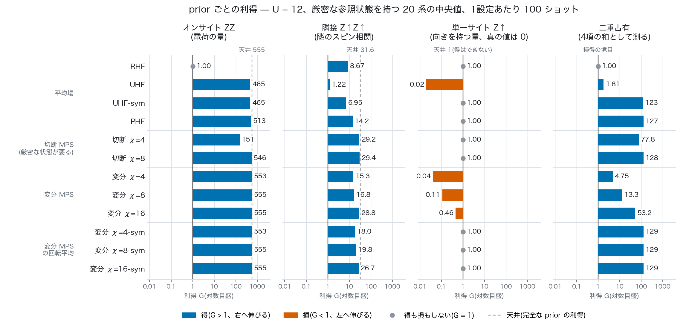
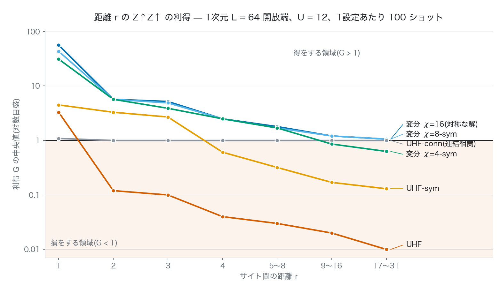
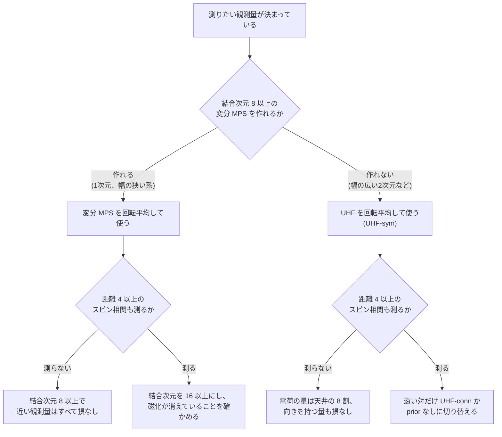

# prior の比較 — どの prior を、どの観測量に使うか

[README.md](README.md) に戻る / 研究全体の見取り図: [README_overview.md](README_overview.md)

図を作るスクリプト: [crm_prior_comparison_figure.py](crm_prior_comparison_figure.py)

この研究では、CRM シャドウに使う prior(古典計算で作った近似状態)を何種類も試してきた。その比較は、試した順に別々の文書に分かれている。この文書は、それらを**1か所にまとめ直したもの**である。新しい計算はしていない。数値はすべて既存の文書からの再掲で、出典は 12 章にまとめた。

読む順番の目安:

- 結論だけ知りたい → 0 章
- なぜそうなるかを知りたい → 3 章(prior の外れを4種類に分ける)と 4 章(結果の表と図)
- 自分の場合にどれを使うか決めたい → 8 章(選び方の手順)

**前提知識について。** この文書は、次の言葉を知っていれば読める。知らない言葉があれば、[README_basics.md](README_basics.md)(線形代数と確率だけを仮定した準備の文書)の該当する節を先に読むとよい。

| 言葉 | 一言でいうと | 準備の文書の節 |
|---|---|---|
| 古典シャドウ、設定、ショット | 基底をランダムに選んで測る方法。基底の組が設定、1回の測定がショット | 3章 |
| CRM、prior、利得 | prior(古典計算で作った近似状態)が出すはずの値を引いて、ばらつきを減らす方法。利得はばらつき(分散)が何分の1になったか | 4章 |
| パウリ文字列、台 | $X,Y,Z$ の積で書ける観測量と、それが触る量子ビットの集まり | 2.4 |
| Hubbard 模型、half-filling(半充填)、 $U$ | 電子が格子を飛び移り、同じサイトに2個入ると $U$ だけ損をする模型。電子の数がサイトの数と同じ場合が半充填 | 5.1〜5.3 |
| 二重占有率 | 1つのサイトに電子が2個いる確率 | 5.3 |
| 一重項、Néel(ネール)配置、磁化 | スピンの逆向きの並び方の2種類と、スピンの偏りの大きさ | 5.5 |
| 平均場(RHF、UHF) | 各電子がほかの電子の平均の中を独立に動くとする近似 | 6.2 |
| MPS、結合次元 $\chi$ 、DMRG | 状態を小さな行列の積で表す方法、その精度のつまみ、それを求める計算法 | 6.4 |

この文書では、電子の数や二重占有のように電子が何個いるかで決まる量を**電荷の量**、スピンの向きや並び方で決まる量を**スピンの量**と呼ぶ。

---

## 0. 結論を先に

先に言葉を3つだけ確認する。**損をする**とは、CRM を使うと標準の方法より分散が大きくなる(利得 $G<1$ )ことである。**天井**とは、完全な prior を使ったときの利得で、それ以上にはならない上限である。**スピンの向きについて平均する**(回転平均)とは、prior が「上向き」として選んでしまった向きを、あらゆる向きに取り直して等しい確率で混ぜることである。

1. **まず試すべきなのは、変分 MPS(結合次元 $\chi\ge8$ )をスピンの向きについて平均したもの(変分 MPS-sym)である。** 厳密な状態を使わずに作れる prior の中で、電荷の量とスピンの量を合わせて最も良かった。厳密な参照状態を持つ 80 系 × 4 観測量のすべてで損をしなかった。
2. **MPS を作れない系(幅の広い2次元など)では、UHF をスピンの向きについて平均したもの(UHF-sym)を使う。** 電荷の量は天井の 8 割に届き、向きを持つ量でも損をしない。ただし隣のスピン相関は天井の 2 割ほどで、距離 4 以上のスピン相関では損をする。
3. **素の UHF・PHF・RHF を単独で選ぶ理由はほとんどない。**
   - 素の UHF は、スピンの向きを含む量で大きく損をする。回転で変わらない量では UHF-sym と同じ値になるので、UHF-sym で置き換えられる。
   - PHF(スピン射影)は、系が大きくなると UHF-sym との差が消える。
   - RHF は、電荷の量でまったく効かない。
4. **prior の順位は観測量で入れ替わる。** その理由は、prior の外れが性質の違う4種類に分かれ、観測量ごとに感じる外れが違うからである(3 章)。prior は古典的な後処理なので、**同じ測定データに対して観測量ごとに prior を変えてよい**(追加の測定は要らない)。

---

## 1. 比べ方の約束

| 用語・記号 | 意味 |
|---|---|
| prior $\sigma$ | 測る状態 $\rho$ の、古典計算で作った近似。CRM は実験の推定値から「同じ設定で $\sigma$ を測ったら出るはずの値」を引き、 $\sigma$ での値を足し戻す。prior が何であっても推定は偏らない |
| $x$ 、 $y$ 、 $\Delta$ | パウリ文字列 $P$ の真の値 $x=\langle P\rangle_\rho$ 、prior の値 $y=\langle P\rangle_\sigma$ 、prior の外れ $\Delta=x-y$ |
| 台 $A$ 、 $\lvert A\rvert$ | $P$ が恒等でない量子ビットの集合と、その個数 |
| 利得 $G$ | 標準の古典シャドウの分散 ÷ CRM の分散。同じ精度に必要な測定の設定(回路)の数が何分の1になるかを表す。 $G>1$ なら得、 $G<1$ なら損 |
| $n_m$ | 1つの設定あたりのショット数。この文書の利得はすべて $n_m=100$ での値 |
| 天井 | prior が完全( $\Delta=0$ )なときの利得。これより大きくはならない |

単一のパウリ文字列では、利得は次の式で決まる(元論文の式(25) [PRX: (C7)] の比。[README_crm_paper.md](README_crm_paper.md))。

```math
G=\frac{(3^{\lvert A\rvert}-1)x^2+v_s}{(3^{\lvert A\rvert}-1)\Delta^2+v_s},\qquad v_s=\frac{3^{\lvert A\rvert}(1-x^2)}{n_m}
```

式の成り立ちを一言でいうと、分子が標準の方法の分散、分母が CRM の分散である。どちらも「どの基底が当たるかのくじの揺らぎ(第1項)」と「同じ設定の中でのショットの揺らぎ $v_s$ (第2項)」の和で、CRM は第1項の $x^2$ を $\Delta^2$ に置き換える。導出は [README_basics.md](README_basics.md) の 3.4 節と 4.3 節にある。

**数値の例。** オンサイト ZZ( $\lvert A\rvert=2$ )で真の値が $x=-0.93$ 、 $n_m=100$ の場合、 $v_s=0.0122$ 、分子は 6.93 である。prior の値が $y=-0.93$ (完全)なら $G=570$ 、 $y=-0.95$ (外れ 0.02)なら 451、 $y=-0.80$ (外れ 0.13)なら 47、 $y=0$ なら 1、 $y=+0.5$ (符号が逆)なら 0.42 になる。わずかな外れで利得が大きく変わるので、prior どうしの差がはっきり出る。

この式から、比較に必要なことが3つ分かる。

1. **prior は外れ $\Delta$ を通してしか利得に効かない。** prior の大域的な忠実度やエネルギーは式に現れない。
2. **損得の境目は $\lvert\Delta\rvert=\lvert x\rvert$ である。** prior の値で言えば、 $y$ が $0$ と $2x$ の間にあれば得、外にあれば損をする。prior の値が真の値の2倍を超えるか、符号が逆なら損である。
3. **真の値が 0 の観測量では、天井が 1 である。** 分子が $v_s$ だけになるので $G\le1$ で、得はできない。問題になるのは損をしないかどうかだけである。理由は、真の値が 0 のとき標準の方法にはくじの揺らぎがもともとなく( $x^2=0$ )、CRM が消すものがないからである。prior が 0 でない値を予言すると、その分のくじの揺らぎを新しく作ってしまう。

二重占有のように複数のパウリ文字列の和で書かれる観測量では、和全体の外れではなく**項ごとの外れ**が分散に入る([README_observables.md](README_observables.md) 5.1)。項ごとに別々の設定で当たるので、ある項の外れと別の項の外れが、期待値では打ち消し合っても、ばらつきでは打ち消し合わないからである。

**数値の出どころ**: 断りがなければ、厳密な参照状態を持つ 80 系のうち $U=12$ の 20 系の中央値である。80 系は、1次元の開放端( $L=8$ 〜 $64$ )と周期境界( $L=8$ 〜 $16$ )、2次元の幅 2 と幅 4(12 サイト以下)の 20 通りの格子に、 $U=2,4,8,12$ を掛けたもので、すべて半充填である。観測量は中央のサイトとその隣で測る。値はモンテカルロではなく、分散の厳密な式から求めている。

言葉を補う。**厳密な参照状態**とは、近似なしで(または十分な精度で)求めた基底状態で、「量子コンピュータの上に用意された、測りたい状態」の役をする。真の値 $x$ はこの状態から計算する。**中央値**は、20 系の利得を大きさの順に並べたときの真ん中の値である。利得は系によって桁で違うので、平均ではなく中央値でまとめている。**モンテカルロ**は、測定を乱数で模擬して分散を数える方法で、繰り返しの数が有限なので誤差を持つ。上の式に $x$ と $y$ を入れて計算すれば、その誤差がない。

---

## 2. 比べる prior の一覧

prior は、作り方で2つの系統に分かれる。

- **平均場の系統(RHF、UHF、UHF-sym、PHF)。** 各電子が、ほかの電子の平均的な影響の中を独立に動く、と近似する。得られる状態は、電子を1個ずつ決まった1粒子の状態(**軌道**)に詰めたもの(Slater 行列式)である。計算が軽く、数百量子ビットでも一瞬で終わる。その代わり、電子どうしが互いを避け合う量子的な効果(相関)が入らない。
- **MPS の系統(切断 MPS、変分 MPS、変分 MPS-sym)。** 状態を小さな行列の積で表す。行列の大きさ(結合次元 $\chi$ )が大きいほど、量子的な相関を多く持てて正確になり、計算は重くなる。

表の言葉を補う。

- **磁化**は、スピンが上向きか下向きに偏っている度合い( $\langle S^z_i\rangle$ の大きさ)である。
- **副格子**は、格子を「隣は必ず別の組」になるように2組に分けたときの各組である。鎖なら奇数番目と偶数番目のサイトである。
- **ネール解**は、一方の副格子のスピンが上、他方が下を向いた解である。上下が交互に並ぶ。
- **全スピン 0** は、すべての電子のスピンを合成した大きさが 0 で、全体としてどの向きも向いていないことを表す。
- **スイープ**は、DMRG で MPS の行列を端から端まで順に1回ずつ最適化する操作である。**局所解**は、最適化が本当の最小ではない途中のくぼみで止まった解である。

| prior | 作り方 | 厳密な状態が要るか | 計算の手間 |
|---|---|---|---|
| RHF | 上向きと下向きの電子に同じ軌道を使う平均場。磁化を持たない。半充填の一様な格子では、軌道は $U=0$ の自由な電子のものと同じになる | 要らない | 行列の対角化 |
| UHF | 上向きと下向きに別の軌道を使う平均場。副格子ごとにスピンを上下に傾けたネール解になる | 要らない | 行列の対角化の反復( $O(N^3)$ ) |
| UHF-sym | UHF をあらゆるスピンの向きに回して、確率的に混ぜた混合状態 | 要らない | UHF と同じ |
| PHF | 回した UHF を量子的に重ね合わせ、全スピン 0 の成分だけを取り出した状態 | 要らない | 回転角の積分点(64 点)の数だけ UHF の計算を繰り返す |
| 切断 MPS | 厳密な状態を結合次元 $\chi$ に切り詰めた MPS | **要る** | 厳密な状態を作る手間そのもの |
| 変分 MPS | 結合次元を $\chi$ に制限した DMRG の基底状態 | 要らない | スイープ1回が $N\chi^3$ に比例。局所解に落ちやすいので、出発点を数個試す |
| 変分 MPS-sym | 変分 MPS をあらゆるスピンの向きに回して、確率的に混ぜた混合状態 | 要らない | 変分 MPS と、その期待値を数個計算するだけ |

補足:

- **切断 MPS は実際の prior としては使えない。** 厳密な状態が手元にあるなら、そもそも測る必要がない。この研究では「結合次元 $\chi$ で表せる prior はどこまで良くなれるか」の目安として使っている。
- **「-sym」(回転平均)は混合状態である。** CRM に必要なのは prior での期待値だけなので、混合状態でも使える。計算は、観測量を「回転で変わらない部分」と「向きを持つ部分」に分け、前者だけを元の状態で計算すればよい([README_uhfsym.md](README_uhfsym.md) 3 章)。例えば $\langle Z_{i\uparrow}Z_{j\uparrow}\rangle$ は $\langle(1-n_i)(1-n_j)\rangle+\tfrac43\langle\mathbf S_i\cdot\mathbf S_j\rangle$ に置き換わる。
- 遠いスピン相関だけに使う **UHF-conn**(連結相関の prior)は 5 章で説明する。
- **「確率的に混ぜる」と「量子的に重ね合わせる」は違う操作である。** 2つのスピンで言うと、「1番が上・2番が下」の状態と「1番が下・2番が上」の状態を確率 $1/2$ ずつで混ぜても、スピン相関 $\langle\mathbf S_1\cdot\mathbf S_2\rangle$ は元の $-\tfrac14$ のままである。符号をつけて重ね合わせると一重項になり、 $-\tfrac34$ になる。UHF-sym は前者(混ぜる)、PHF は後者(重ね合わせる)に当たる。混ぜるだけなら向きは消えるが量子的な相関は増えない。重ね合わせると量子的な相関が加わるが、その量は系が大きいと薄まる(3.2 節)。

---

## 3. prior の外れは4種類に分けられる

prior の順位が観測量で入れ替わる理由は、この章の2つの表を見比べると分かる。

### 3.1 4種類の外れ

外れを分類する前に、真の状態がどういう状態かを確認する。

- **真の状態はどの向きも向いていない。** Hubbard 模型は、すべてのスピンを同じだけ回しても変わらない(スピン回転の対称性)。「上」と呼ぶ向きに特別な意味はない。半充填の有限の系では、基底状態も全体としてどの向きも向いていない状態(全スピン 0)になる。したがって、どのサイトでもスピンの平均は 0 である。
- **隣り合うスピンは、量子的に逆向きになっている。** 2つのスピンが逆向きに並ぶ仕方には2種類ある。

| 並び方 | 中身 | 個々のスピンの平均 | $\langle\mathbf S_i\cdot\mathbf S_j\rangle$ |
|---|---|---|---|
| ネール配置(古典的) | 「 $i$ は上、 $j$ は下」と決まっている | 上か下に偏る | $-\tfrac14$ |
| 一重項(量子的) | どちらが上かは決まっていないが、必ず逆向き | 0 | $-\tfrac34$ |

格子の中では、1つのスピンが隣すべてと同時に一重項を組むことはできないので、真の値はこの2つの間になる(1次元で $-0.443$ 、2次元の正方格子で約 $-0.335$ )。

- **真の状態には、わずかな二重占有がある。** 強結合では電子は各サイトに1個ずつ収まるが、隣へ一瞬飛んで戻る過程があり、その分だけ二重占有率が 0 でない小さな値( $U=12$ で約 0.018)を持つ。

prior がこの3つの性質のどれを外すかで、外れを分類する。

| 記号 | 外れの種類 | 中身 |
|---|---|---|
| ① | **向きの外れ** | 真の状態(有限系の基底状態)は全スピン 0 で、どのサイトでも $\langle\mathbf S_i\rangle=0$ である。prior がスピンの向きを1つ選ぶと、 $\langle S^z_i\rangle\ne0$ がそのまま外れになる |
| ② | **一重項の相関の不足** | 隣り合うスピンが量子的に一重項を組む相関が足りない。古典的なネール配置(反平行の積状態)の $\langle\mathbf S_i\cdot\mathbf S_j\rangle$ は $-\tfrac14$ 、一重項は $-\tfrac34$ で、真の状態はその間にある |
| ③ | **偽の長距離秩序** | 向きを選んだ prior の $\langle\mathbf S_i\cdot\mathbf S_j\rangle$ には、距離によらない $\langle\mathbf S_i\rangle\cdot\langle\mathbf S_j\rangle=\pm m^2$ が含まれる( $m$ は磁化)。真の相関は距離とともに減衰するので、遠い対で外れる。この部分は回転で変わらないので、**回転平均しても消えない** |
| ④ | **電荷のゆらぎの外れ** | 二重占有率(同じサイトに電子が2つ入る確率)が合わない |

### 3.2 どの prior がどの外れを持つか

表の読み方: 行が prior、列が外れの種類である。「なし」はその外れを持たないこと、「大」「あり」は持つことを表す。**太字**は、その prior の弱点になっている外れである。

数値は $U=12$ のもの。①は中央サイトの磁化 $\lvert\langle S^z\rangle\rvert$ (1次元 $L=64$ )、②は隣の $\langle\mathbf S_i\cdot\mathbf S_j\rangle$ の相対誤差、④は中央の二重占有率(1次元 $L=64$ 、真の値は 0.0178)である。磁化は最大で 0.5(スピンが完全に上か下を向いた場合)なので、UHF の 0.49 はほぼ完全に偏っていることを意味する。相対誤差は、prior の値と真の値の差を真の値で割ったものである。

| prior | ① 向き | ② 一重項の不足 | ③ 偽の長距離秩序 | ④ 電荷のゆらぎ |
|---|---|---|---|---|
| RHF | なし | あり(自由な電子の値のままで、 $U$ によらない) | なし | **大**(二重占有率が無相関の値 $\tfrac14$ のまま) |
| UHF | **大**(磁化 0.49) | あり(誤差 35%) | あり | 小(0.0136) |
| UHF-sym | なし | あり(UHF と同じ値) | **あり(残る)** | 小(UHF と同じ値) |
| PHF | なし | あり(真の値との差の 11% しか埋まらない) | あり | 小(0.0140) |
| 切断 $\chi=4$ | なし | ほぼなし(誤差 3%) | なし | **大**(0.0000) |
| 切断 $\chi=8$ | なし | ほぼなし | なし | ほぼなし |
| 変分 $\chi=4$ | **あり**(磁化 0.30) | 中(誤差 21%) | あり | ほぼなし(0.0173) |
| 変分 $\chi=8$ | あり(磁化 0.18) | 小(誤差 11%) | 少しあり | ほぼなし |
| 変分 $\chi=16$ | 1次元開放端の $U\ge8$ ではなし。周期境界と2次元ではあり | 小(誤差 5%) | 1次元開放端の $U\ge8$ ではなし | ほぼなし |
| 変分 $\chi=4$ -sym | なし | 中 | あり(残る) | ほぼなし |
| 変分 $\chi=8$ -sym | なし | 小 | わずかに残る | ほぼなし |
| 変分 $\chi=16$ -sym | なし | 小 | 1次元ではなし | ほぼなし |

この表から読み取れること:

- **回転平均(-sym)が消すのは①だけである。** ②と④は元の状態の値がそのまま残り、③も残る。
- **PHF は②をほとんど直さない。** 射影は系全体の向きを1つ回復するだけで、1つの結合に配られる量子的な相関は系の大きさ $L$ に反比例して薄まる([README_phf_mps.md](README_phf_mps.md) 3.2)。
- **2種類の MPS は、同じ $\chi=4$ でも性質が逆である。** 切断 MPS は重みの大きい成分から残すので、スピンの成分を上下対称に残して電荷のゆらぎを捨てる(④が大)。変分 MPS はエネルギーを下げる成分から残すので、電荷のゆらぎを残して、スピンの向きを1つに決める(①があり)([README_phf_mps.md](README_phf_mps.md) 4 章)。
- **平均場は②を持ち、MPS は持たない。** 1枚の Slater 行列式は、隣り合うスピンが入れ替わる量子的なゆらぎを表せない。MPS は結合ごとに量子的な相関を持てる。一重項は「上下」と「下上」の2つの配置の重ね合わせなので、表すには少なくとも2つの配置が要る。Slater 行列式は(スピンについては)1つの配置しか持てないが、MPS は結合次元の分だけ配置を重ね合わせられる。
- **RHF が④で大きく外れる理由。** RHF では上向きと下向きの電子が互いに無関係に動くので、あるサイトに上向きがいる確率 $\tfrac12$ と下向きがいる確率 $\tfrac12$ の積で、二重占有率が $\tfrac14$ になる。 $U$ をどれだけ大きくしても変わらない。真の値( $U=12$ で 0.018)の 14 倍である。
- **UHF が④で小さく済む理由。** UHF では上向きの電子が一方の副格子に、下向きが他方に偏る。同じサイトに両方がいる確率は $(\tfrac12+m)(\tfrac12-m)=\tfrac14-m^2$ で、 $m=0.49$ なら約 0.01 になる。向きを選ぶという代償を払って、二重占有を避けている。

### 3.3 どの観測量がどの外れを感じるか

「感じる」とは、その種類の外れがあると、観測量についての prior の値 $y$ が真の値 $x$ からずれる、という意味である。記号を確認しておく。 $Z_{i\uparrow}$ は、サイト $i$ の上向きの電子の席に対応する量子ビットの $Z$ で、席が空なら $+1$ 、埋まっていれば $-1$ を返す( $Z_{i\uparrow}=1-2n_{i\uparrow}$ )。

| 観測量 | ① 向き | ② 一重項の不足 | ③ 偽の長距離秩序 | ④ 電荷のゆらぎ |
|---|---|---|---|---|
| オンサイト ZZ( $Z_{i\uparrow}Z_{i\downarrow}$ )、電荷の偶奇 | — | — | — | **感じる** |
| 単一サイト $Z_{i\uparrow}$ | **感じる** | — | — | — |
| 二重占有・局所エネルギー(和として測る) | **感じる**(項ごとに) | — | — | **感じる** |
| 隣接 $Z_{i\uparrow}Z_{j\uparrow}$ (隣のスピン相関) | **感じる** | **感じる** | — | わずかに |
| 遠い $Z_{i\uparrow}Z_{j\uparrow}$ (距離 4 以上) | **感じる** | — | **感じる** | — |

- オンサイト ZZ と電荷の偶奇は、電子数と二重占有だけで書ける量で、スピンの向きを回しても変わらない。だから①〜③を感じない。
- 単一サイト $Z_{i\uparrow}=1-n_i-2S^z_i$ は、半充填では真の値が 0 で、prior の磁化がそのまま外れになる。この式は、 $n_i=n_{i\uparrow}+n_{i\downarrow}$ と $S^z_i=(n_{i\uparrow}-n_{i\downarrow})/2$ から $n_{i\uparrow}=n_i/2+S^z_i$ と書き、 $Z_{i\uparrow}=1-2n_{i\uparrow}$ に代入すると出る。半充填では $\langle n_i\rangle=1$ 、真の状態では $\langle S^z_i\rangle=0$ なので、期待値は 0 である。磁化 $m$ を持つ prior では $\mp2m$ になる。
- 隣接 $Z_{i\uparrow}Z_{j\uparrow}$ は、強結合では各サイトに電子が1個ずついるので $Z_{i\uparrow}\approx-2S^z_i$ となり、ほぼ $4S^z_iS^z_j$ 、つまりスピン相関の $z$ 成分である。 $z$ という特定の向きの成分なので①を感じ、隣のスピン相関の強さそのものなので②を感じる。
- 二重占有 $n_{i\uparrow}n_{i\downarrow}=\tfrac14(1-Z_{i\uparrow}-Z_{i\downarrow}+Z_{i\uparrow}Z_{i\downarrow})$ は全体としては回転で変わらないが、和として測ると $Z_{i\uparrow}$ と $Z_{i\downarrow}$ の項が別々に効く。磁化による外れは2つの項で逆向きで、合計では打ち消し合うが、分散では打ち消されない。

**2つの表を掛け合わせると、4 章の結果がほぼ説明できる。** 例えば UHF は①が大きく④が小さいので、オンサイト ZZ では良く、単一サイトと二重占有(和)では悪い。切断 $\chi=4$ は④が大きく②がないので、その逆になる。

---

## 4. 結果: prior × 観測量



**図の読み方**: 横軸は利得 $G$ (対数目盛)で、縦の実線が損得の境目 $G=1$ である。棒が右へ伸びていれば得、左へ伸びていれば損で、灰色の点は得も損もしない( $G=1$ )ことを表す。破線は天井(完全な prior の利得)である。二重占有(4項の和)の天井は計算していない。

同じ数値を表にする。記号の意味は次のとおり。

- ◎: 天井(天井がない列では最良の prior)の 8 割以上
- ○: 得をする( $G\ge2$ )
- △: ほとんど効かない( $0.99\le G<2$ )
- ×: 損をする( $G<0.99$ )

| prior | オンサイト ZZ(天井 555) | 隣接 $Z_\uparrow Z_\uparrow$ (天井 31.6) | 単一サイト $Z_\uparrow$ (上限 1) | 二重占有(4項の和) | 遠い $Z_\uparrow Z_\uparrow$ ( $r\ge4$ ) |
|---|---|---|---|---|---|
| RHF | △ 1.00 | ○ 8.67 | 1.00(上限) | △ 1.00 | 損なし(約 1) |
| UHF | ◎ 465 | △ 1.22 | × 0.02 | △ 1.81 | × |
| UHF-sym | ◎ 465 | ○ 6.95 | 1.00(上限) | ◎ 123 | × |
| PHF | ◎ 513 | ○ 14.2 | 1.00(上限) | ◎ 127 | × |
| 切断 $\chi=4$ | ○ 151 | ◎ 29.2 | 1.00(上限) | ○ 77.8 | 損なし |
| 切断 $\chi=8$ | ◎ 546 | ◎ 29.4 | 1.00(上限) | ◎ 128 | 損なし |
| 変分 $\chi=4$ | ◎ 553 | ○ 15.3 | × 0.04 | ○ 4.75 | × |
| 変分 $\chi=8$ | ◎ 555 | ○ 16.8 | × 0.11 | ○ 13.3 | $r\ge16$ で × |
| 変分 $\chi=16$ | ◎ 555 | ◎ 28.8 | × 0.46 | ○ 53.2 | 損なし |
| 変分 $\chi=4$ -sym | ◎ 553 | ○ 18.0 | 1.00(上限) | ◎ 129 | $r\ge9$ で × |
| **変分 $\chi=8$ -sym** | ◎ 555 | ○ 19.8 | 1.00(上限) | ◎ 129 | ほぼ損なし |
| **変分 $\chi=16$ -sym** | ◎ 555 | ◎ 26.7 | 1.00(上限) | ◎ 129 | 損なし |

(左の4列は $U=12$ の 20 系の中央値。右端の列は1次元 $L=64$ 開放端、 $U=12$ での結果で、5 章で詳しく見る。)

### 4.1 電荷の量(オンサイト ZZ、電荷の偶奇)

感じる外れは④(電荷のゆらぎ)だけである。

- **変分 MPS は $\chi=4$ から天井に届く。** 二重占有率を正しく持つからである(真の値 0.0178 に対して 0.0173)。回転平均しても値は変わらない。
- **UHF は天井の 84% に届く。** オンサイト ZZ の真の値は $4\times0.0178-1=-0.929$ 、UHF の値は $4\times0.0136-1=-0.946$ で、外れは 0.017 しかない。二重占有率そのものは 24% も小さいのに、 $-1$ に近い量に直すと外れが 2% になる。 UHF の二重占有率は少し小さい(0.0136)が、強結合ではオンサイト ZZ の値 $4d-1$ ( $d$ は二重占有率)が $-1$ に張り付くので、相対的な外れは小さい。
- **切断 $\chi=4$ は UHF に負ける**(151 対 465)。電荷のゆらぎを捨てているからである。 $\chi=8$ で電荷の成分が入り、天井に届く。
- **RHF はまったく効かない**( $G=1$ )。RHF のオンサイト ZZ は 0 で、prior が何も言わないのと同じである( $d=\tfrac14$ を $4d-1$ に入れると 0。 $y=0$ では引く量が 0 になり、CRM は標準の方法と同じになる)。
- **電荷の偶奇**は、ある範囲のサイトにいる電子の総数が偶数か奇数かを表す量で、その範囲のすべての席の $Z$ の積で書ける。16 サイト分の電荷の偶奇(台 32 量子ビット、1次元 $L=64$ )でも順位は同じで、UHF と UHF-sym が 591、切断 $\chi=4$ が 150、変分 MPS が 666〜669、天井が 671 である。

### 4.2 隣のスピン相関(隣接 $Z_\uparrow Z_\uparrow$ )

感じる外れは①(向き)と②(一重項の不足)である。

- **UHF はほとんど効かず、20 系中 7 系で損をする。** UHF は相関を $z$ 方向に集めてしまうので、prior の値が $-0.97$ になり、真の値( $-0.5$ 前後)の約2倍になる。損得の境目( $y=2x$ )のすぐ近くである。 $-0.97$ という値は次のように出る。UHF では $\langle Z_{i\uparrow}\rangle=\mp2m$ で、隣のサイトでは符号が逆になる。UHF は2つのサイトをほぼ独立に扱うので、積の期待値はほぼ $-(2m)^2$ で、 $m=0.49$ なら $-0.96$ である。真の状態では、逆向きの相関が $x$ 、 $y$ 、 $z$ の3方向に等しく分かれているので、 $z$ 成分はもっと小さい。
- **UHF-sym にすると損が消える**(80 系で 17 系 → 0 系)。回転平均で相関が3方向に配り直され、prior の値が $-0.34$ になる(UHF の $\langle\mathbf S_i\cdot\mathbf S_j\rangle\approx-\tfrac14$ を3方向に等分すると、 $z$ 成分は $-\tfrac1{12}$ 。 $Z_\uparrow Z_\uparrow\approx4S^zS^z$ なので $-\tfrac13$ )。真の値 $-0.5$ 前後に対して今度は小さすぎるが、0 と $2x$ の間にあるので得をする。ただし②が残るので、天井の 22% にとどまる。
- **MPS は②を持たないので天井に近づく。** 切断 MPS は $\chi=4$ で天井の 92% である。変分 MPS は①が邪魔をするが、回転平均で①を取り除くと、 $\chi=8$ で 19.8、 $\chi=16$ で 26.7 になり、UHF-sym(6.95)を大きく上回る。
- **PHF は UHF-sym の約2倍だが、これは小さい系が多いためである。** 同じ系どうしの比の中央値は、16 サイト以下で 2.1 倍、24 サイト以上で 1.25 倍に下がる。
- **RHF は UHF-sym より少し良い**(8.67 対 6.95)。ただし RHF の値は自由な電子の結合の振幅で決まり、実際の一重項の強さとは連動しないので、結合の向きによっては逆転する(2本脚の梯子の段の結合で RHF 1.64、UHF-sym 5.79)。

### 4.3 向きを持つ量(単一サイト $Z_\uparrow$ )

感じる外れは①だけで、天井は 1 である。**得はできず、損をしないことだけが問題になる。**

- 向きを選ばない prior(RHF、UHF-sym、PHF、切断 MPS、変分 MPS-sym)は、値が 0 になって $G=1$ である。
- 向きを選ぶ prior は、磁化がそのまま外れになる。UHF の値は $\mp2m\approx\mp0.97$ である。利得の式に $x=0$ 、 $\Delta=0.97$ 、 $\lvert A\rvert=1$ 、 $n_m=100$ を入れると、 $v_s=3/100=0.03$ 、分母は $2\times0.97^2+0.03=1.91$ で、 $G=0.03/1.91=0.016$ になる。UHF は 0.02(分散が 50 倍に増える)で、20 系すべてで損をする。変分 MPS も $\chi=4$ で 20 系すべて、 $\chi=16$ でも1次元開放端以外の 11 系すべてで損をする。

### 4.4 和の観測量(二重占有、局所エネルギー)

感じる外れは①(項ごとに)と④である。

二重占有 $n_{i\uparrow}n_{i\downarrow}$ は、 $n=(1-Z)/2$ を代入すると $\tfrac14(1-Z_{i\uparrow}-Z_{i\downarrow}+Z_{i\uparrow}Z_{i\downarrow})$ になる。3つのパウリ文字列 $Z_{i\uparrow}$ 、 $Z_{i\downarrow}$ 、 $Z_{i\uparrow}Z_{i\downarrow}$ の和である。UHF は $\langle Z_{i\uparrow}\rangle=-2m$ 、 $\langle Z_{i\downarrow}\rangle=+2m$ と予言する(真の値はどちらも 0)。和の期待値では $-2m$ と $+2m$ が打ち消し合うので、二重占有率そのものはよく合う。しかし分散には、それぞれの項の外れが別々に入る。

- **UHF は 1.81 まで落ちる。** オンサイト ZZ の項はほぼ完璧なのに、 $Z_\uparrow$ と $Z_\downarrow$ の項の磁化による外れで利得を失う。
- **UHF-sym にすると 123 になる。** 磁化による外れが消えるからである。
- **変分 MPS も同じ理由で落ち**(4.75〜53.2)、**回転平均で 129 に戻る。**
- 結合のエネルギー(10 項の和、1次元の 5 系の中央値)でも同じである。UHF が 1.65、UHF-sym が 50.9、切断 $\chi=8$ が 60.3、切断 $\chi=32$ が 60.4 で、UHF-sym は MPS とほぼ並ぶ。RHF は 0.75 で損をする。

**測り方の工夫**: 半充填で $\langle n_i\rangle=1$ と分かっているなら、二重占有は $Z_{i\uparrow}Z_{i\downarrow}$ だけで測ればよい。 $Z_\uparrow$ と $Z_\downarrow$ の項は真の値が 0 で、どんな prior でも消せないショットのばらつきを持ち込むからである。そうすると利得は 4.1 節のオンサイト ZZ の値(UHF でも 465)になる。

### 4.5 ホッピング(運動エネルギー)

ホッピングは、電子が隣のサイトへ飛び移る項 $c^\dagger_{i\sigma}c_{j\sigma}+c^\dagger_{j\sigma}c_{i\sigma}$ の期待値で、結合1本分の運動エネルギーに当たる。量子ビットでは $(XZX+YZY)/2$ という台 3 のパウリ文字列2本の和になる。ホッピングは電子1個の動きだけで決まる量(電子どうしの相関を直接には含まない量)なので、平均場でも正確に出せる。1次元の 5 系の中央の結合の中央値:

| $U$ | 真の値の大きさ | UHF | RHF | 切断 $\chi=4$ | 切断 $\chi=8$ | 切断 $\chi=32$ |
|---|---|---|---|---|---|---|
| 2 | 0.590 | 50.1 | 42.8 | 3.47 | 40.5 | 50.9 |
| 4 | 0.488 | 23.8 | 8.90 | 8.57 | 26.1 | 31.0 |
| 8 | 0.312 | 7.50 | 0.97 | 8.93 | 9.97 | 11.4 |
| 12 | 0.220 | 4.45 | 0.33 | 1.00 | 5.72 | 5.92 |

- **UHF はどの $U$ でも最良の MPS に近い。** この結合では回転平均しても値は変わらない。
- **利得そのものは $U$ とともに下がる。** 強結合ではホッピングの値が小さくなり、天井が下がるためで、prior のせいではない。
- **RHF は強結合で損をする。** RHF のホッピングは $U=0$ の値のまま(約 0.64)で、 $U=12$ では真の値の約3倍になり、損得の境目を越える。

---

## 5. 遠いスピン相関



ここまでは隣どうしの量を見てきた。この章では、離れた2つのサイトのスピン相関 $Z_{i\uparrow}Z_{j\uparrow}$ を、距離 $r=\lvert i-j\rvert$ ごとに見る。1次元の真の状態では、スピン相関の大きさは距離とともに小さくなっていく(減衰する)。

**図の読み方**: 横軸はサイト間の距離 $r$ 、縦軸は $Z_{i\uparrow}Z_{j\uparrow}$ の利得の中央値(対数目盛)である。色を付けた下半分が損をする領域である。1次元 $L=64$ 開放端、 $U=12$ で、端の影響を避けて中央の半分にある対だけを使った。

| prior | $r=1$ | $r=2$ | $r=3$ | $r=4$ | $r=5$ 〜8 | $r=9$ 〜16 | $r=17$ 〜31 |
|---|---|---|---|---|---|---|---|
| UHF | 3.3 | 0.12 | 0.10 | 0.04 | 0.03 | 0.02 | 0.01 |
| UHF-sym | 4.5 | 3.3 | 2.7 | **0.61** | 0.32 | 0.17 | 0.13 |
| UHF-conn | 1.09 | 1.00 | 1.00 | 1.00 | 1.00 | 1.00 | 1.00 |
| 切断 $\chi=8$ | 60.1 | 5.2 | 4.5 | 2.2 | 1.6 | 1.16 | 1.03 |
| 変分 $\chi=4$ | 60.0 | 3.1 | 1.8 | 0.46 | 0.25 | 0.13 | 0.10 |
| 変分 $\chi=4$ -sym | 31.2 | 5.7 | 3.9 | 2.5 | 1.7 | **0.86** | 0.63 |
| 変分 $\chi=8$ -sym | 43.4 | 5.7 | 4.9 | 2.5 | 1.7 | 1.21 | 1.06 |
| 変分 $\chi=16$ | 56.4 | 5.7 | 5.2 | 2.5 | 1.8 | 1.21 | 1.06 |

- **向きを選んだ prior は、回転平均しても遠くで損をする。** 3.1 節の③(偽の長距離秩序)が残るからである。UHF-sym の値は遠い対でも約 $\tfrac43m^2\approx0.33$ のままで、減衰する真の値の2倍を $r=4$ で超える。 $\tfrac43m^2$ は次のように出る。UHF では、どれだけ離れた2サイトでもスピンは「同じ副格子なら同じ向き、違う副格子なら逆向き」にそろっているので、 $\langle\mathbf S_i\cdot\mathbf S_j\rangle\approx\pm m^2$ である。回転平均で $z$ 成分はその $\tfrac13$ になり、 $Z_\uparrow Z_\uparrow\approx4S^zS^z$ なので $\pm\tfrac43m^2$ 。 $m=0.49$ なら 0.32 である。
- **損が始まる距離は、元の状態の磁化が小さいほど遠くなる。** UHF-sym(磁化 0.49)は $r=4$ から、変分 $\chi=4$ -sym(磁化 0.30)は $r=9$ から損をする。変分 $\chi=8$ -sym(磁化 0.18)は最も遠い対のうち 2% で損をするだけである。 $U=12$ の変分 $\chi=16$ はもともと磁化がなく、損をしない。
- **UHF-conn は、偽の秩序を差し引いた値である**( $\langle\mathbf S_i\cdot\mathbf S_j\rangle$ から $\langle\mathbf S_i\rangle\cdot\langle\mathbf S_j\rangle$ を引く)。これはどの状態の期待値でもないが、CRM の推定は偏らない(prior の値はどんな数でもよい)。損はしないが、遠い対では値がほぼ 0 になるので得もしない。
- **遠い対ほど、どの prior でも利得は 1 に近づく。** 真の相関が小さくなり、CRM で減らせる分散そのものが小さくなるためである。

**平均場しか使えないときの使い分け**: 近い対( $r\le3$ )には UHF-sym、遠い対には UHF-conn(または prior なし)を使う。prior は観測量ごとに選べるので、追加の測定は要らない。

---

## 6. prior ごとのまとめ

| prior | 得意 | 苦手 | 使いどころ |
|---|---|---|---|
| RHF | スピンの量で損をしない。弱結合のホッピング | 電荷の量( $G=1$ )。強結合のホッピングと局所エネルギーで損 | 単独で選ぶ理由はほぼない |
| UHF | 電荷の量、ホッピング。計算が安く、系の幅に鈍い | 向きを含む量すべて(単一サイト、和の観測量、スピン相関) | 測る状態自体が同じ向きに対称性を破っているとき(7.4 節) |
| **UHF-sym** | UHF の得意な量はそのまま。向きを持つ量で損をしない。和の観測量が大きく改善 | 隣のスピン相関は天井の 2 割。遠いスピン相関で損 | **MPS を作れない系での第一候補** |
| PHF | 十数サイト以下では隣のスピン相関が UHF-sym の約2倍 | 効果が系の大きさに反比例して消える。行き過ぎることがある | 数十量子ビット以上では使う意味がない |
| 切断 MPS | $\chi\ge8$ でほぼすべての観測量が良い | 厳密な状態が要る。 $\chi=4$ では電荷の量が悪い | 実際には使えない。上限の目安 |
| 変分 MPS | 電荷の量( $\chi=4$ から天井)、エネルギー | 低い $\chi$ で向きを選ぶ。単一サイトと和の観測量で損 | 必ず回転平均して使う |
| **変分 MPS-sym** | $\chi\ge8$ で近い観測量すべてに損がない。隣のスピン相関で UHF-sym の 3〜4 倍( $U=12$ ) | 遠いスピン相関は $\chi$ が小さいと損。 $\chi=4$ は局所解の影響が残る | **MPS を作れる系での第一候補** |

---

## 7. 条件が変わると順位はどう変わるか

ここまでの数値は、 $U=12$ 、半充填、小さい系の中央値という1つの条件でのものだった。この章では、条件を1つずつ変えたときに結論がどう動くかを見る。

### 7.1 相互作用の強さ $U$

80 系の $U$ ごとの中央値。

| 観測量 | prior | $U=2$ | $U=4$ | $U=8$ | $U=12$ |
|---|---|---|---|---|---|
| オンサイト ZZ | UHF(= UHF-sym) | 2.3 | 50.3 | 188 | 465 |
| 隣接 $Z_\uparrow Z_\uparrow$ | UHF | 8.33 | 1.89 | 1.33 | 1.22 |
| | UHF-sym | 12.4 | 11.2 | 7.82 | 6.95 |
| | RHF | 14.9 | 12.1 | 9.31 | 8.67 |
| | 切断 $\chi=4$ | 1.00 | 16.0 | 26.5 | 29.2 |
| | 切断 $\chi=8$ | 14.3 | 22.6 | 27.5 | 29.4 |
| 二重占有(4項の和) | UHF | 0.99 | 1.20 | 1.63 | 1.81 |
| | UHF-sym | 2.13 | 28.0 | 79.5 | 123 |
| | 切断 $\chi=8$ | 6.08 | 27.9 | 86.2 | 128 |

- **電荷の量では、UHF は強結合ほど良い。** $U$ が大きいほど電荷が凍り(電子が各サイトに1個ずつ収まって動かなくなり、二重占有率が 0 に近づき)、平均場がよく捉えるからである。弱結合( $U=2$ )では 2.3 しかなく、MPS(1次元で約 10)に大きく劣る。
- **スピンの量では、UHF 系は強結合ほど悪い。** 強結合では真の状態が一重項に近づくのに、UHF は古典的なネール配置のままだからである(②)。MPS は逆に、強結合ほど良くなる。
- **中間の強さ( $U=4$ )では、UHF-sym と変分 MPS-sym の差が小さい。** 隣接 $Z_\uparrow Z_\uparrow$ は UHF-sym が 11.2、変分 $\chi=8$ -sym が 11.7、 $\chi=16$ -sym が 18.9 である。オンサイト ZZ と二重占有はほぼ同じである(50.3 と 50.1〜50.6、28.0 と 28.0〜28.1)。
- **弱結合では低い $\chi$ の MPS に注意する。** 切断 $\chi=4$ は $U=2$ で隣接スピン相関が 1.00 になり、損をする系もある。

### 7.2 系の大きさ

- **prior の順位は、系を大きくしてもほとんど変わらない。** 利得を決める外れ $\Delta$ は、観測量の台の近くだけで決まる局所的な量だからである。UHF のオンサイト ZZ( $U=12$ )は $L=8$ で 464.6、 $L=64$ で 472.3 で、その間に大域的な忠実度は 2 万分の 1 になる。
- **例外は PHF である。** 効果が $1/L$ で消える(4.2 節)。
- **変分 MPS は、鎖が長いほど向きを選びやすい。** $\chi=8$ の磁化は $L=8$ で 0.005、 $L=64$ で 0.178 である。対称な(向きを選ばない)状態は、系の左半分と右半分のスピンが量子的に強く絡み合った状態で、鎖が長いほど必要な絡み合いが増える。それが $\chi=8$ に入りきらなくなると、DMRG は絡み合いの少なくて済む「向きを選んだ状態」の方へ落ちる。回転平均しておけば、近い観測量には影響しない。

### 7.3 次元と境界条件

シリンダーは正方格子を一方向だけ環につないで筒にしたもので、幅は筒の周のサイトの数である。トーラスは両方向を環につないだものである。

**幅を広げると、MPS だけが苦しくなる。** MPS は量子ビットを1列に並べて作るので、2次元の格子は蛇行する1本の鎖に並べ直して扱う。その鎖を途中で切ると、筒の周にある幅の本数だけの結合を一度に切ることになる。切り口を横切る量子的な相関が幅に比例して増え、必要な結合次元が幅について指数的に増えるからである。UHF の手間は $O(N^3)$ のままである。以下の MPS は、参照状態を切り詰めた切断 MPS である。

| 系 | 観測量 | UHF | UHF-sym | MPS(小さい $\chi$ ) | MPS(大きい $\chi$ ) | 天井 |
|---|---|---|---|---|---|---|
| 幅 4 のシリンダー、 $U=4$ | オンサイト ZZ | 27.0 | 27.0 | 13.0( $\chi=16$ ) | 28.6( $\chi=64$ ) | 28.9 |
| | 隣接 $Z_\uparrow Z_\uparrow$ | 0.97 | 8.68 | 6.8( $\chi=16$ ) | 8.9( $\chi=64$ ) | |
| 幅 6 のシリンダー、 $U=8$ | オンサイト ZZ | 148 | 148 | 103( $\chi=32$ ) | 146( $\chi=128$ ) | 149.6 |
| 4×4 トーラス、厳密な参照 | オンサイト ZZ | | 142.5 | 76.1( $\chi=32$ ) | | |
| | 隣接 $Z_\uparrow Z_\uparrow$ | | 10.7 | 11.2( $\chi=32$ ) | | |

- **オンサイトの量では、UHF が $\chi=64$ 〜 $128$ の MPS に並ぶ。**
- **スピン相関は、幅 4 では UHF-sym が $\chi=64$ に並ぶ。** ただし幅 6 の $U=8$ では、 $\chi\ge8$ の MPS が 27〜51 で、UHF(5.6)をはるかに上回る。強結合のスピン相関では、2次元でも MPS の方が良い。
- **周期境界は「幅 2 の2次元」に相当する。** 端と端をつなぐ結合の相関も鎖の中を通すので、MPS に不利になる。
- **変分 MPS は、周期境界と2次元では $\chi=16$ でも向きを選ぶ**(幅 4 の 12 サイトで磁化 0.43)。回転平均が必須である。大きな2次元系で必要な $\chi$ は分かっていない。

### 7.4 測る状態が対称性を破っているとき

ここまでの結論は、測る状態がスピン回転の対称性を持つ場合のものである。**測る状態自体が向きを選んでいるときは、素の UHF の方が合うことがある。**

- 幅 4 のシリンダー( $U=4$ )では、参照状態(結合次元 192 の DMRG)がネール的に対称性を破っていた。つまり、測る状態の役をする DMRG の解が、十分に収束しておらず、スピンを上下交互に偏らせた状態になっていた。このとき単一サイトの $Z_\uparrow$ の真の値は 0 ではなく、同じ向きに偏った UHF の方が値をよく言い当てる。二重占有(和)は UHF が 6.9、UHF-sym が 3.4 で、回転平均すると悪くなった。
- 幅 6 のシリンダーでは、隣接 $Z_\uparrow Z_\uparrow$ ( $U=4$ )で UHF が 8.3、UHF-sym が 4.9 だった。

**原則は「prior の対称性を、測る状態の対称性に合わせる」である。** どちらか分からないときは、同じ測定データで両方を試せばよい。

もう1つの例外は、**一重項に近い強い結合**である。回転平均すると prior の値の大きさが約 $\tfrac13$ に抑えられるので、真の相関がそれより十分強い結合では控えめすぎになる(1次元の開放端の強い結合で、UHF 9.45、UHF-sym 3.38)。

### 7.5 ドープした系

ドープとは、半充填から電子を抜くことである。抜けた跡をホール(正孔)と呼ぶ。8 サイトにつき1個の割合で抜いた場合が 1/8 ドープである。ホールは一様には広がらず、線状に集まる。その線(壁)を境に、スピンの上下交互の並びが1つずれる。この模様をストライプと呼ぶ。

1/8 のホールを入れた系では、電荷が縞模様(ストライプ)を作り、平均場はそこで破綻する。

| 幅 4、 $U=8$ 、1/8 ドープ | UHF | UHF-sym | 切断 $\chi=16$ | 切断 $\chi=64$ |
|---|---|---|---|---|
| 隣接 $Z_\uparrow Z_\uparrow$ | 0.66 | 10.1 | 4.8 | 12.7 |
| 二重占有 | 0.91 | 16.5 | 18.1 | 45.7 |

- **スピンの量は、縞の壁から離れた領域なら UHF-sym で救える**(幅 6 で 8.5〜11.6)。**壁の上では救えない**(0.74〜1.4)。
- **サイトごとの電子密度は、平均場ではどこでも無理である**(0.1〜2.7)。 $\chi\ge32$ の MPS が要る。
- $U=4$ のドープ系では、半充填で UHF が得意だったオンサイト ZZ でも損をする(0.81)。

### 7.6 ショット数と読み出し誤差

- **ショット数 $n_m$ は利得の大きさを変えるが、prior の順位は変えない。** 同じ系・同じ観測量では真の値が共通なので、利得は外れの大きさだけで順序が決まる。
- **読み出し誤差**は、測定の最後に $+1$ と $-1$ を読み間違える装置の誤りである。パウリ文字列の値は台の量子ビットの測定値の積なので、どれか1つでも読み間違えると符号が変わる。台が大きいほど、測った値は真の値より 0 に近く縮む。**台の大きい観測量では、読み出し誤差を prior にも掛ける必要がある。** 掛けないと、prior が完全でも損をする(台 32 の電荷の偶奇で、誤差率 1% なら 591 → 1.1)。損に転じる誤差率は約 $0.35/\lvert A\rvert$ である([README_readout_noise.md](README_readout_noise.md))。これは prior の種類によらない。

---

## 8. 選び方の手順

半充填の系での手順である。



図に入れていない注意:

1. **測る状態が対称性を破っているかもしれないとき**(収束しきっていない状態、対称性を破る外場がある実験)は、回転平均した prior としない prior の両方を同じデータで試す(7.4 節)。
2. **ドープした系で電荷の模様があるとき**は、模様の壁の近くとサイトごとの密度に平均場を使わない(7.5 節)。
3. **台の大きい観測量**(電荷の偶奇など)では、読み出し誤差のモデルを prior に掛ける(7.6 節)。
4. **対称性から値が 0 と分かっている成分は、観測量から外す**(4.4 節の測り方の工夫)。
5. **prior を信用しきれないときは、9 章の最適係数を保険にする。**

---

## 9. prior に重ねて使える工夫

どれも prior の側の古典的な後処理で、追加の測定は要らない。

表の言葉を補う。**制御変量法**は、平均のわかっている似た量を引いて分散を減らす統計の方法で、CRM はその一種である。引く量に係数 $\beta$ を掛け、分散が最も小さくなる $\beta$ をデータから決めると、prior が悪いときは $\beta$ が自動的に 0 に近づくので、損をしなくなる。**回帰**は、複数の prior のそれぞれに係数を掛けて引き、係数の組をデータから決めることである。**並進**は、格子全体を1サイトずらす操作である。

| 工夫 | 中身 | 効果 | 出典 |
|---|---|---|---|
| 観測量ごとの使い分け | 同じ測定データに、観測量ごとに別の prior を使う | 各観測量で最良の prior を選べる | [README_uhfsym.md](README_uhfsym.md) 6 章 |
| 最適係数 | prior を引く量に係数 $\beta$ を掛け、 $\beta$ をデータから決める(制御変量法) | prior がどれほど悪くても損をしない。prior が良いときは $\beta=1$ に固定する方が良い | [README_experiments.md](README_experiments.md) §6 |
| 複数の prior の回帰 | UHF と UHF-sym を同時に使い、配合をデータから決める | 幅 4、 $U=8$ の二重占有で、単独の 10.3 と 5.2 に対して 82( $\chi=32$ の MPS と同じ) | 同上 |
| 並進の平均 | 同じ観測量の prior の値を全サイトで平均する(周期境界の系) | 切断 MPS の位置による外れが消え、 $\chi=4$ でも完全な prior に並ぶことがある(隣接 $Z_\uparrow Z_\uparrow$ で 32.66 対 32.70)。悪くなる観測量もある | [README.md](README.md) §2j |
| 誤差込みの prior | 読み出し誤差のモデルを prior にも掛ける | 台の大きい観測量で損をしなくなる | [README_readout_noise.md](README_readout_noise.md) |

---

## 10. よくある誤解

表の言葉を補う。**大域的な忠実度**は、2つの状態が系全体としてどれだけ重なっているかを表す数(一致すれば 1)である。**相関エネルギー**は、平均場のエネルギーと真の基底状態のエネルギーの差で、平均場が取りこぼした分に当たる。

| 誤解 | 実際 | 例 |
|---|---|---|
| 大域的な忠実度が高い prior ほど良い | 利得を決めるのは観測量ごとの外れで、忠実度は式に現れない | 1次元 $L=12$ 、 $U=8$ のオンサイト ZZ で、忠実度 0.078 の UHF が 190、忠実度 0.83 の切断 $\chi=4$ が 111 |
| エネルギーが低い prior ほど良い | エネルギーは④に敏感で、①や②とは別である | 切断 $\chi=4$ は UHF よりエネルギーが高いのに、隣のスピン相関は 29.2(UHF は 1.22)。変分 $\chi=4$ は相関エネルギーの約 8 割を取り戻すのに、単一サイトで損(0.04) |
| 結合次元を上げれば必ず良くなる | 変分 MPS は、 $\chi$ を上げたときに向きの選び方が変わることがある | 隣接 $Z_\uparrow Z_\uparrow$ の 16 サイト以下の中央値が、変分 $\chi=4$ で 18.1、 $\chi=8$ で 7.90 |
| 回転平均すれば必ず良くなる | 消えるのは向きの外れだけ。測る状態が向きを持つとき、強い一重項の結合では悪くなる | 7.4 節の 6.9 → 3.4、9.45 → 3.38 |
| 射影(PHF)は平均(UHF-sym)より常に良い | 大きい系では差が消え、遠い対では悪くなることがある | 1次元 $L=64$ の $r=3$ で、損をする対が UHF-sym の 0% から PHF の 48% に増える |
| 秩序をはっきり持つ prior の方が、値を強く予言するので良い | 予言が真の値の2倍を超えると損をする | UHF の単一サイト $Z_\uparrow$ ( $\pm0.97$ と予言、真の値は 0)で 0.02 |

---

## 11. 限界

- **模擬実験である。** 参照状態は DMRG か厳密対角化で作ったもので、実機の雑音は入っていない(読み出し誤差だけは式で見積もった)。
- **中心の比較は 80 系の中央値で、24 サイト以上は1次元だけである。** 2次元の厳密な参照は 16 サイトまでである。
- **変分 MPS は、4〜6 個の出発点から最良のものを採っただけである。** 別の局所解に落ちれば、向きの選び方と、その結果の利得が変わりうる。 $\chi=4$ ではその影響が見えている。
- **大きな2次元系で、変分 MPS-sym がどこまで使えるかは分かっていない。** 幅 6 の系の MPS は、参照状態を切り詰めたものしか試していない。
- **2次元では、遠いスピン相関の結論が変わるかもしれない。** 2次元では真の状態自体が長距離秩序に近づくからである。5 章は1次元だけの結果である。
- **この文書の順位は半充填でのものである。** ドープした系は 7.5 節の範囲しか調べていない。
- 平均場より先の prior(電荷の分布を合わせた平均場など)は試していない。

---

## 12. 出典

| この文書の内容 | 元の文書 |
|---|---|
| 利得の式、損得の境目(1 章) | [README_crm_paper.md](README_crm_paper.md)、[README_eigenstate.md](README_eigenstate.md) 1.4 |
| UHF-sym の定義と計算(2 章) | [README_uhfsym.md](README_uhfsym.md) |
| PHF、切断 MPS、変分 MPS の作り方と性質(2 章、3.2 節、4 章) | [README_phf_mps.md](README_phf_mps.md) |
| 変分 MPS-sym(4 章の表、7.1 節) | [README_varsym.md](README_varsym.md) |
| 遠いスピン相関と UHF-conn(5 章) | [README_varsym_distance.md](README_varsym_distance.md) |
| RHF(4 章、7.1 節) | [README_eigenstate.md](README_eigenstate.md) 3.6 |
| 和の観測量、ホッピング、局所エネルギー、電荷の偶奇(4.1、4.4、4.5 節) | [README_observables.md](README_observables.md) 5 章 |
| $U$ 依存、系の大きさ、忠実度との関係(7.1、7.2 節、10 章) | [README_prior_survey.md](README_prior_survey.md) |
| 2次元、ドープ系、最適係数(7.3〜7.5 節、9 章) | [README_experiments.md](README_experiments.md) §4、§6、§8、§9、[README.md](README.md) §2k |
| 読み出し誤差(7.6 節) | [README_readout_noise.md](README_readout_noise.md) |
